# CodeRokers

A full-stack developer blog built with **React**, **Tailwind CSS** and **Appwrite**. Read articles, search and filter them, write your own in a Markdown editor with live preview, and manage your account, all with a dark/light theme and a fully responsive layout.


**[Live demo](https://surajverma003.github.io/coderockers/)** · **[Source code](https://github.com/surajverma003/coderockers)**

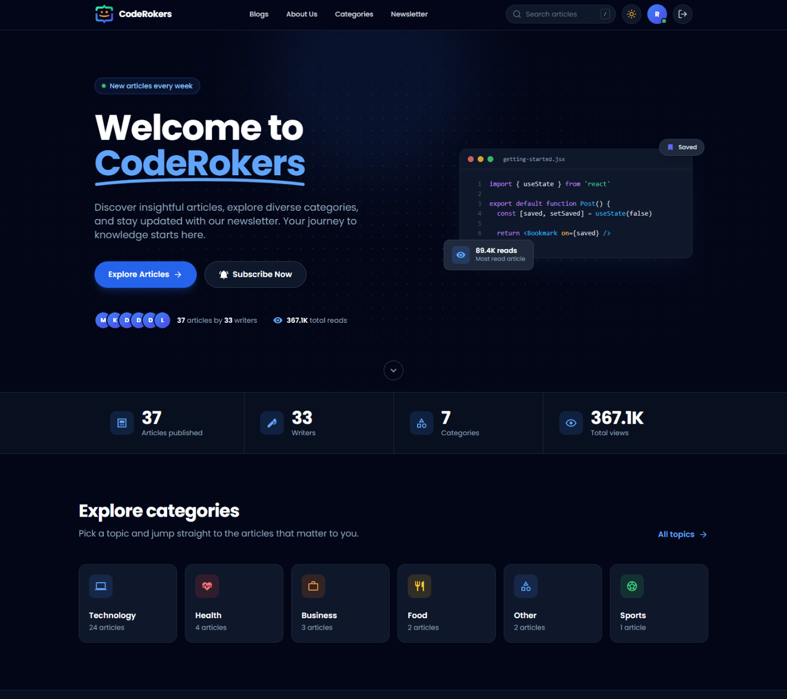

## Screenshots

### Desktop

| Home (light) | Articles | Article page |
| :---: | :---: | :---: |
| 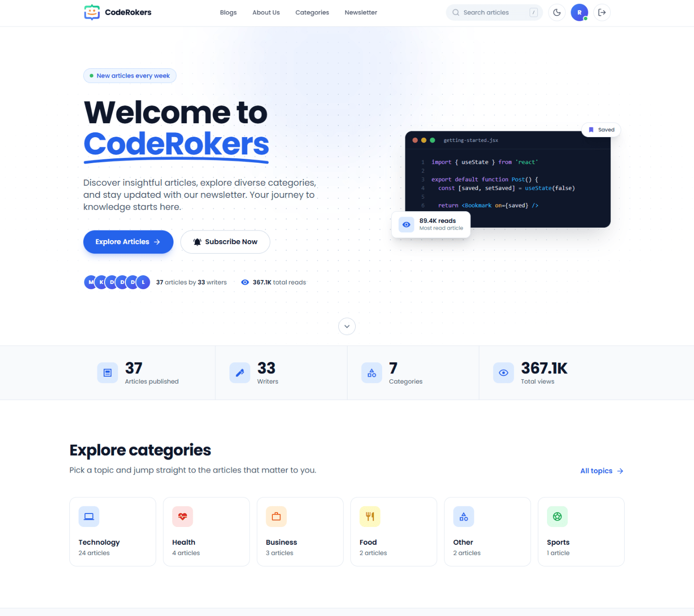 | 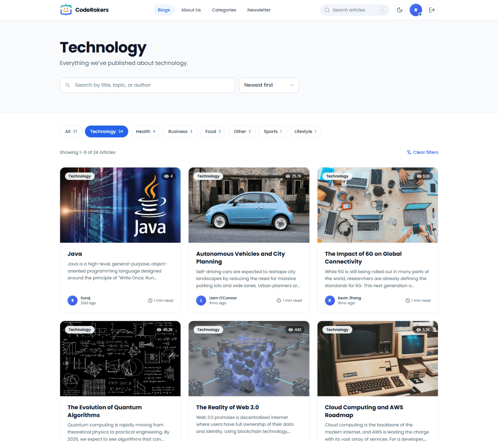 | 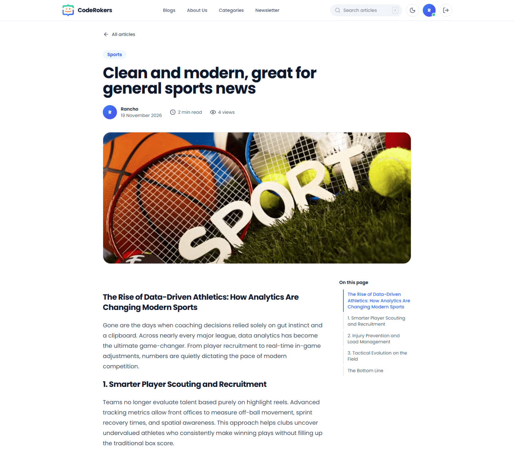 |

| Editor | Profile settings | Categories |
| :---: | :---: | :---: |
| 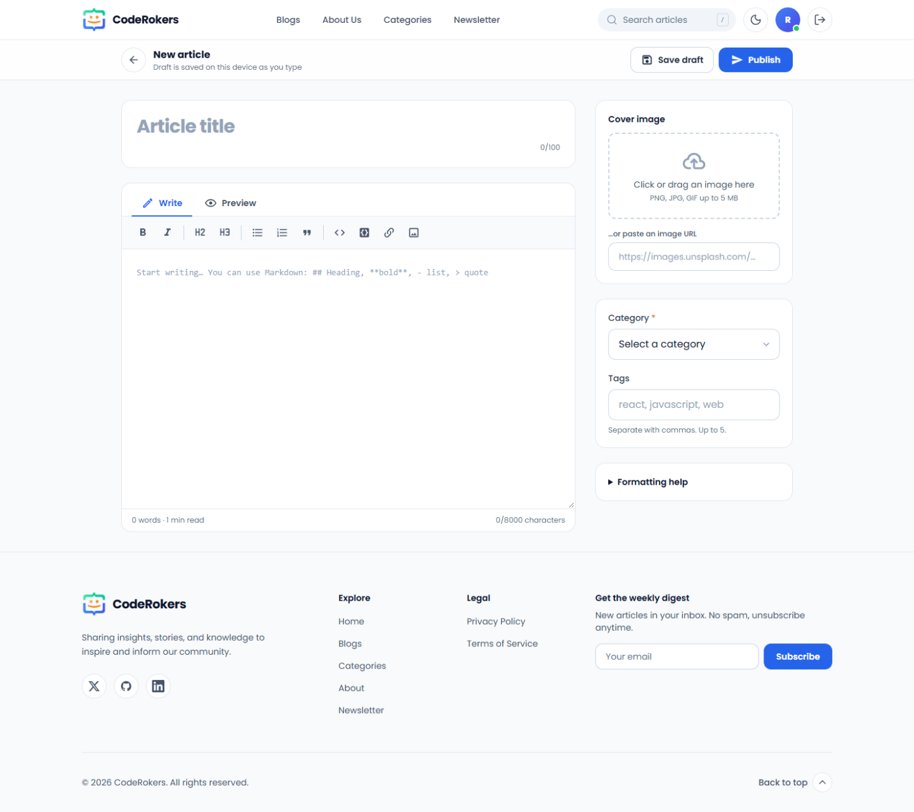 | 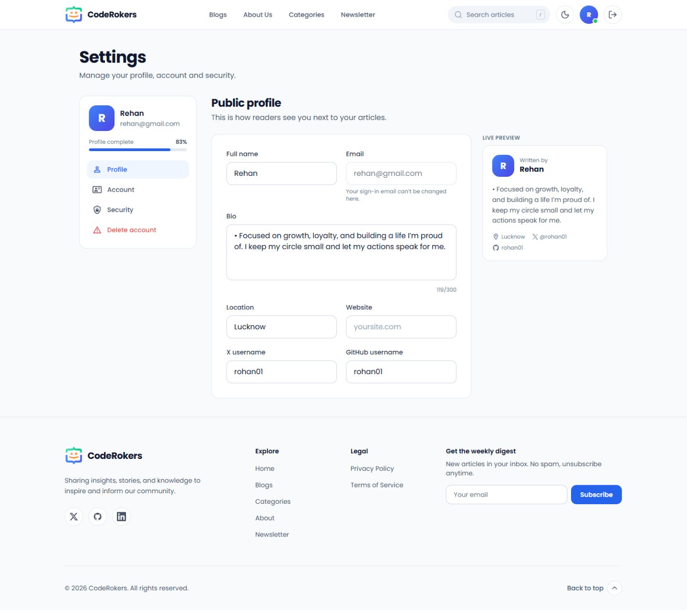 | 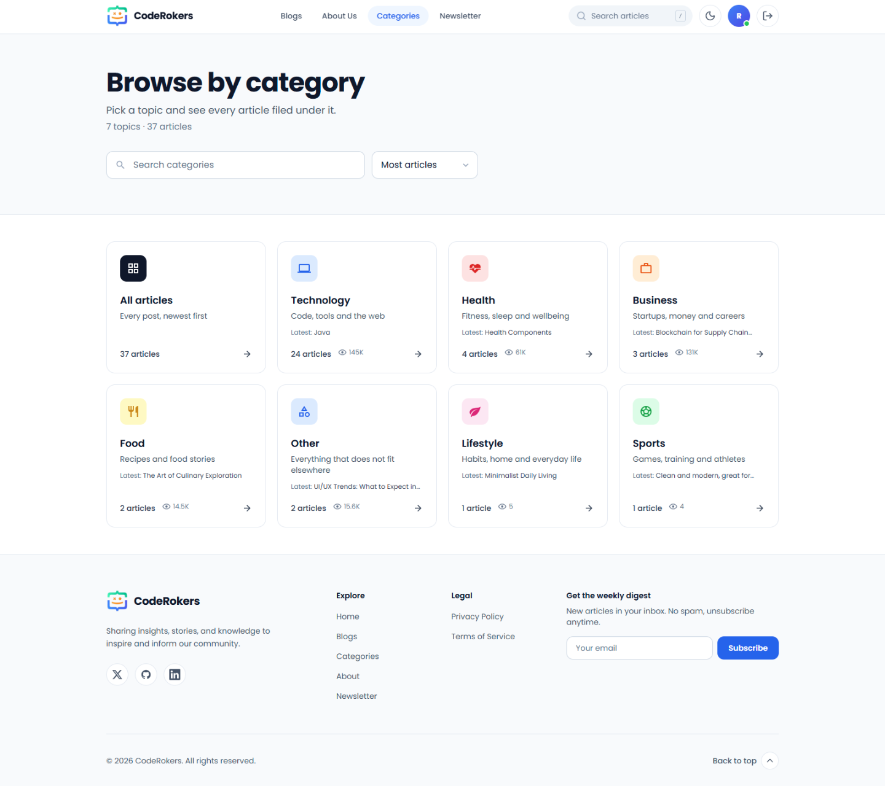 |

### Mobile

| Home | Profile settings | Admin dashboard | Categories | Newsletter |
| :---: | :---: | :---: | :---: | :---: |
| 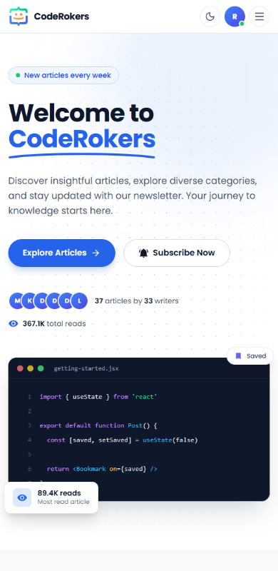 | 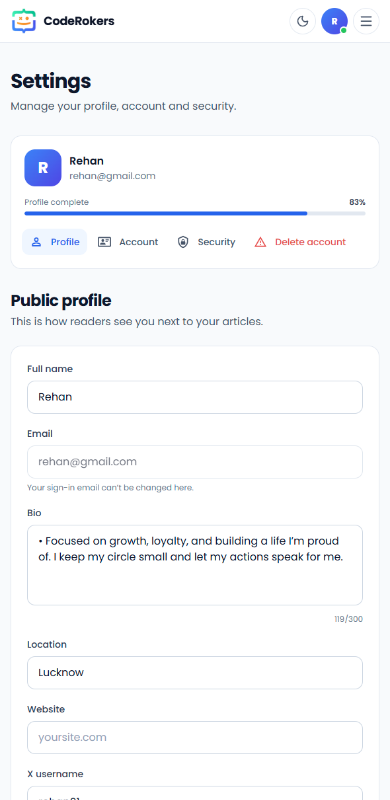 | 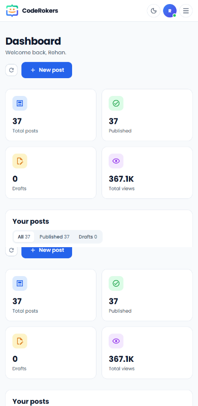 | 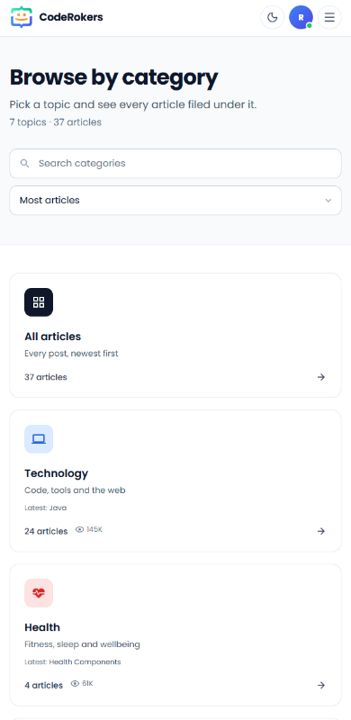 | 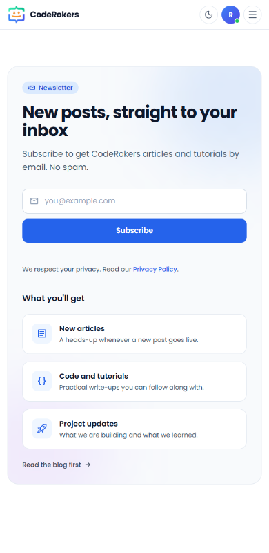 |

| Privacy policy | Terms of service |  |  |  |
| :---: | :---: | :---: | :---: | :---: |
| 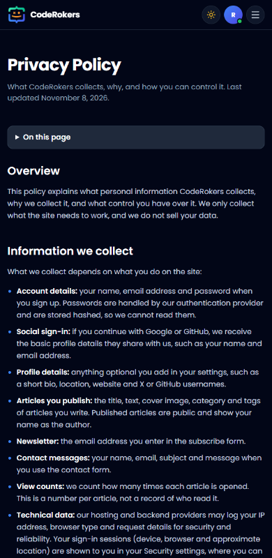 | 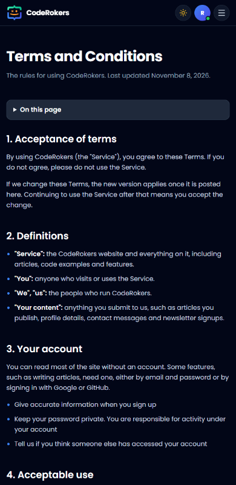 |  |  |  |

## Features

**Reading**
- Article list with search, category filter, sorting (newest, oldest, most viewed, A-Z) and pagination
- Category pages (`/category/technology`) and search from the navbar
- Article page with reading progress bar, table of contents, related posts, share buttons (WhatsApp, X, LinkedIn, copy link)
- Home page powered by real data: category counts, stats, most-read articles, latest articles, top writers

**Writing**
- Markdown editor with toolbar, keyboard shortcuts (Ctrl+B / I / K) and a live **Preview** tab
- Drafts and publishing (`is_published`), draft autosave on the device, unique slugs generated from the title
- Cover image by URL (or upload to Appwrite Storage, optional), category and tags

**Accounts**
- Email/password, Google and GitHub sign-in
- Forgot password (email link, one-time, expires in 1 hour) and change password
- Profile settings: public profile with live preview, account details, active sessions with sign-out per device

**Everything else**
- Newsletter signup and contact form, both saved to Appwrite
- Dark and light mode, skeleton loaders, custom 404 page
- Accessibility: keyboard focus styles, labelled forms, ARIA live messages, reduced-motion support

## Tech stack

| Area | Tools |
| --- | --- |
| UI | React, React Router, Tailwind CSS |
| Icons | Iconify, lucide-react |
| Backend | Appwrite (Auth, Database, optional Storage) |
| Tooling | Vite |

## Routes

| Path | Page |
| --- | --- |
| `/` | Home |
| `/blogs`, `/category/:category` | Article list |
| `/view-blog/:slug` | Article |
| `/create-blog` | Editor (login required) |
| `/profile` | Profile settings |
| `/login`, `/signup` | Sign in / sign up |
| `/forgot-password`, `/change-password` | Password reset and change |
| `/newsletter`, `/about`, `/privacy`, `/terms` | Newsletter + contact, about, legal |

## Project structure

```
src/
├── appwrite/      Appwrite client setup
├── components/    Pages and layout (Home, Blogs, ViewBlog, CreateBlog, Navbar, Footer, ...)
├── context/       Global state: user, cached posts, auth helpers
├── reuse/         Shared UI (profile popup, auth layout, Markdown renderer)
└── utils/         Helpers (post normalizing, newsletter, views, password rules)
```

## Known limitations and roadmap

- **Edit and delete post** are not built yet. Only create is available. Next step: author-only update/delete using Appwrite row permissions.
- **Views counter** runs from the browser (one count per browser per 24 hours). This needs update access on the table, so the plan is to move it into an Appwrite Function.
- **Newsletter** collects emails but does not send them yet. Sending needs Appwrite Messaging or a Function.
- **Testimonials** on the home page are demo content. They are meant to be replaced by comments stored in the database.
- **Config** values (database ID, table IDs) are constants in code. Moving them to environment variables is planned.
- **Tests** are not added yet.

## What I learned

- Appwrite permissions apply to the whole row, not to single fields. That is why a safe views counter needs a Function instead of a client-side update.
- Keeping filters in the URL removed a lot of state-syncing code between the navbar, list page and category pages.
- Auth is mostly edge cases: expired links, users without passwords, rate limits and stale sessions each need their own handling.

## Author

**Suraj Verma** · [GitHub](https://github.com/surajverma003) · [LinkedIn](https://www.linkedin.com/in/surajverma003)

## LICENSE

MIT
